# AquaSave

AquaSave is a static front-end website for an ocean cleanup initiative in the Philippines (SDG 14, Life Below Water). It has a landing page, an operations dashboard and login/register pages. There is no backend and no build step.

## Pages

| File | What it is |
| --- | --- |
| `index.html` | Landing page: preloader, hero ocean canvas, mission stats, Philippine hotspot map, four animal cards with video modal, reef floor |
| `dashboard.html` | Operations dashboard: KPIs, yearly growth line chart, tonnage by hotspot, site analytics map, rescue log, live activity, field log ledger |
| `login.html` | Log in (client-side only) |
| `register.html` | Create account (client-side only) |

## Folder structure

```text
Aquasave/
├─ index.html
├─ dashboard.html
├─ login.html
├─ register.html
├─ README.md
└─ assets/
   ├─ css/
   │  ├─ style.css      Theme, layout, hero, map, animals, dashboard, performance rules
   │  └─ badge.css      Animated AquaSave seal (starburst, ring, droplet)
   ├─ fonts/            (fonts load from Google Fonts; folder kept for local fallbacks)
   ├─ images/
   │  ├─ graphics/
   │  │  ├─ animals/    seaturtle, whaleshark, threshershark, mantaray, plastic_bottle (.png)
   │  │  └─ logo/       ASAVE.png
   │  └─ vectors/       philippines.svg, aqua-save-mark.svg
   └─ js/
      ├─ main.js        Preloader, depth background, floating creatures, reveals, counters,
      │                 animal cards + morph video modal, water ripples, reef sway
      ├─ hero.js        Cursor-following ocean canvas in the hero
      ├─ ph-path.js     Outline path of your Philippine map (PH_PATH)
      ├─ ph-map.js      Site data (PH_SITES) + interactive map: filters, zoom, pan, clusters, tooltip
      ├─ chart.js       Canvas line chart (sweeps in from the left, hover/pin/keyboard)
      └─ dash.js        Dashboard logic: KPIs, bars, field log form + ledger, live feed
```

`animals.js`, `animation.js`, `app.js`, `perf.js` and `validation.js` are from the earlier version of the site. The merged pages do not load them. Keep or delete them, but do not add them back to the pages or they will conflict with the new scripts.

## Paths

Every page must reference files under `assets/`:

```html
<link rel="stylesheet" href="assets/css/style.css">
<link rel="stylesheet" href="assets/css/badge.css">
<script src="assets/js/ph-path.js"></script>
<script src="assets/js/ph-map.js"></script>
<script src="assets/js/hero.js"></script>      <!-- index.html only -->
<script src="assets/js/chart.js"></script>     <!-- dashboard.html only -->
<script src="assets/js/dash.js"></script>      <!-- dashboard.html only -->
<script src="assets/js/main.js"></script>

```

Script order matters: `ph-path.js` before `ph-map.js`, and `ph-map.js` before `dash.js` and `main.js`. `index.html` also needs the `.../animals/...` images under `assets/images/graphics/animals/` and the map image under `assets/images/vectors/`.

## Features

- **Preloader:** the AquaSave logo sits in the centre while a wave fills the screen, then the hero text rises in.
- **Hero:** original "The sea keeps everything we give it." heading with a canvas ocean that bends around the cursor and shows a depth readout.
- **Depth background:** light turquoise at the top that darkens as you scroll.
- **Creatures:** floating sea turtle, plastic bottle and whale shark with parallax, plus animated waves and a swaying reef floor.
- **Hotspot map:** your own SVG map of the Philippines with year, focus and status filters, zoom and pan, cluster view, pulsing dots and a location table.
- **Animals:** four cards (whale shark, thresher shark, sea turtles, manta ray). Clicking one morphs the card into a video modal and shrinks it back on close.
- **Water ripples:** subtle ripples follow the cursor. They are off over the map and while the modal is open.
- **Seal:** the animated AquaSave seal appears on login, register and the landing badge row.
- **Dashboard:** counters, "Archipelago Growth (2021–2026)" line chart, "2026 Tonnage by Hotspot" bars, site analytics map, rescue log, live activity and a field log ledger with add, delete and clear.

## Running locally

1. Keep the folder structure above.
2. Serve the folder with XAMPP/Apache or VS Code Live Server, or open `index.html` directly.
3. An internet connection is needed for Google Fonts and the CDN libraries.

External libraries (CDN): GSAP 3.12.5, ScrollTrigger 3.12.5, Lenis 1.1.13. Fonts: Space Grotesk, Inter, Bricolage Grotesque.

## Data and storage

All data stays in the browser (`localStorage`):

| Key | Used for |
| --- | --- |
| `aquasave_accounts` | Registered accounts (name, email, password) |
| `aquasave_session` | Current login |
| `aquasave_profile` | Name and email shown in the dashboard nav and greeting |
| `aquasave_logs` | Field log entries added on the dashboard |

The login and register pages are a demo. Passwords are stored unencrypted in the browser, so do not use real passwords.

## Editing content

- **Sites and yearly tonnage:** the `PH_SITES` array in `assets/js/ph-map.js`. The map, the dashboard totals, the chart and the bars all read from it.
- **Animal text and videos:** the `ANIMALS` object in `assets/js/main.js`. Paste a YouTube video ID to change a video.
- **Landing page stats:** the `data-count` values in `index.html` (1,942 t, 14 zones, 87 species).
- **Chart goal line:** the `GOAL` value in `assets/js/chart.js` (2,500 t).
- **Default log entries:** `DEFAULT_LOGS` in `assets/js/dash.js`.

## Performance and accessibility

- Animations use transforms and opacity, and decorative loops pause when off-screen.
- Background animation pauses while the animal modal is open, and the video loads only after the morph finishes.
- A lighter mode switches on automatically for devices with 4 or fewer CPU cores, 4 GB of RAM or less, or narrow phone screens. It removes the bubbles and ripples and reduces the hero canvas work.
- `prefers-reduced-motion` turns off most motion.

## Rubric coverage

- **CSS transforms and transitions:** hover and press states, card lift, morph modal, parallax, ripples.
- **SVG animation:** waves, reef sway, map dots and rings, the AquaSave seal.
- **Canvas:** hero ocean and the dashboard line chart.
- **Structure:** four pages, `assets/` folder organisation, and the seal, badges and certification emblems.

## Sources for the facts on the landing page

Global Affairs Canada (Pure Oceans story), Greenpeace Philippines, Daily Guardian citing the World Bank, UN INFO, and Solitude World (marine life in the Philippines). Site figures are sample data.